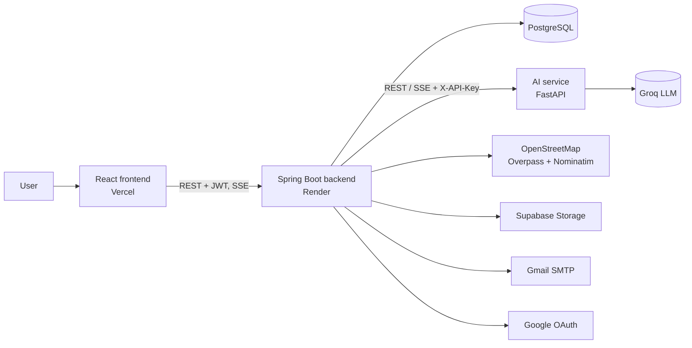
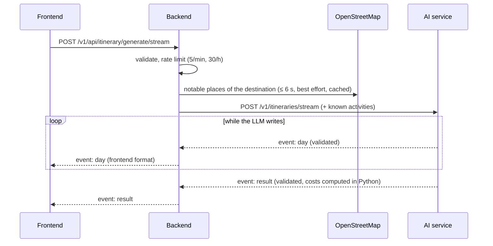

# ⚙️ Atlas Backend


> **Atlas** is a travel platform that plans trips with AI. This repository is the
> **Spring Boot backend**: authentication, users, saved itineraries, integrations
> (OpenStreetMap, Supabase, Gmail) and the gateway to the AI service. It is also the entry point
> to run the **whole platform** locally.

## 👩‍💻 Developer
**Luisa Cerin Ogbeiwi**

## 🌐 Live Demo

[atlas-works.vercel.app](https://atlas-works.vercel.app)

---

## 🗺️ The Atlas platform

| Repository | Stack | Responsibility |
|---|---|---|
| [atlas-frontend](https://github.com/browny26/atlas-frontend) | React 19, Vite, Tailwind | UI, streamed itinerary rendering |
| **atlas-backend** (this) | Java 21, Spring Boot 3.5 | Security, users, data, integrations, AI gateway |
| [atlas-ai_service](https://github.com/browny26/atlas-ai_service) | Python 3.12, FastAPI, Pydantic | Prompts, LLM calls, validation, cost calculation |



Each service has one job. Java owns users, data and security; Python owns everything
about AI. The backend never talks to the LLM, and the AI service never sees user data.

### Generating an itinerary



---

## 🚀 Run everything locally

```bash
git clone https://github.com/browny26/atlas-backend.git
git clone https://github.com/browny26/atlas-ai_service.git
git clone https://github.com/browny26/atlas-frontend.git
cd atlas-backend
cp .env.example .env        # add your keys (Groq, Google, ...)
docker compose up --build
```

| URL | What |
|---|---|
| http://localhost:5173 | Frontend |
| http://localhost:8080/swagger-ui.html | Backend API docs (OpenAPI) |
| http://localhost:8000/docs | AI service API docs |

### Backend only

Requirements: Java 21 and PostgreSQL (Maven comes with the wrapper).

```bash
./mvnw spring-boot:run      # reads .env through spring-dotenv
./mvnw verify               # all tests (the integration test needs Docker)
```

---

## ✨ Features

- 🔐 **Authentication**: JWT, plus Google sign-in verified server-side
- 🤖 **AI itineraries**: generated by the AI service, **streamed day by day** (SSE), with
  the option to **regenerate a single day** following user feedback
- 🎯 **Grounding**: real, notable places of the destination (OpenStreetMap) are given to the LLM
- 🧳 **Saved itineraries**: CRUD, always scoped to the logged-in user
- 🗺️ **Activities near a point**: museums, monuments, parks... from OpenStreetMap (free, no API key)
- ✈️ **Airport search** from a bundled dataset (OurAirports, public domain); flight prices are
  compared on Google Flights / Skyscanner / Kayak through prefilled links (frontend)
- 🖼️ **Supabase**: avatar upload
- 📧 **Gmail**: password reset e-mails

---

## 🧭 Architecture

Layered: `controller → service → repository / client`, with DTOs at the edges.

```
src/main/java/com/back/atlas/
├── controller/   HTTP layer only: validation (@Valid), status codes, SSE
├── service/      business logic (itineraries, generation, grounding, auth, users)
├── client/ai/    typed HTTP client for the AI service (records = the contract)
├── client/places/ ActivityProvider interface + OpenStreetMap implementation
├── mapper/       entity/DTO and AI-contract/frontend translations
├── repository/   Spring Data JPA
├── entity/       JPA entities (itinerary details stored as JSONB)
├── security/     JWT, Google token verification, rate limiting
├── config/       Spring Security, CORS, AI client, typed properties
└── exception/    global error handling (uniform JSON errors)
src/main/resources/db/migration/   Flyway migrations
```

### Design decisions

| Decision | Why |
|---|---|
| **Separate AI microservice** | The AI ecosystem is in Python; prompts and providers change without redeploying the backend; the LLM key lives in one place. |
| **Anti-corruption layer** (`AiItineraryMapper`) | The AI contract uses typed numbers (`cost_eur: 16.0`); the frontend and the DB use display strings (`"€16"`). The mapper keeps both sides independent. |
| **Grounding is best effort** | The lookup runs on a virtual thread with a 6 s timeout: if OpenStreetMap is slow or down, generation goes on without it. |
| **Providers behind an interface** (`ActivityProvider`) | Amadeus closed its self-service APIs in July 2026: it was replaced by OpenStreetMap (Overpass + Nominatim) with one new implementation; the grounding service only swapped the interface it depends on. OSM has no popularity score, so places with a Wikipedia/Wikidata entry rank first. Answers are cached (Caffeine) to respect the free services' usage policies. |
| **Airports from a static file** | ~3,200 airports with scheduled flights (OurAirports) loaded in memory: instant search, no key, no network. Italian city names ("Roma", "Parigi") are mapped to the dataset's English names. |
| **Rate limiting** (Bucket4j + Caffeine) | `/generate` is public and every call costs LLM tokens. Token buckets per user (or per IP, taking the proxy-added `X-Forwarded-For` hop, which clients cannot forge). Memory is bounded. |
| **Ownership checks everywhere** | Every itinerary query includes the user id; `/user/{id}` and `/save/{userId}` must match the JWT user (403 otherwise). |
| **Google login verified server-side** | The client sends only the Google access token; the backend checks its audience (our client id) and reads the verified email from Google. |
| **Flyway owns the schema** | V1 is the schema Hibernate used to create (existing databases are baselined); `ddl-auto=none` in production and `validate` in tests, so CI proves that migrations and entities match. |
| **Uniform errors** | `GlobalExceptionHandler` maps exceptions to 400/401/403/404/409/413/429/502 with a JSON body (`message`, `fieldErrors`); internal details are logged, never returned. |
| **Gson as HTTP JSON mapper** | Historical choice (the old Amadeus SDK returned Gson types), kept to avoid changing every response format: DTOs are plain classes, not records (Gson 2.8). The AI and OSM clients use their own Jackson mappers. |

---

## 📡 API

Full, interactive documentation: **`/swagger-ui.html`**.

| Endpoint | Auth | Description |
|---|---|---|
| `POST /v1/api/auth/register`, `/login`, `/google` | – | Sign up / sign in (JWT) |
| `POST /v1/api/auth/request-reset-password`, `/reset-password` | – | Password reset by e-mail |
| `POST /v1/api/itinerary/generate` | – (rate limited) | Generate an itinerary |
| `POST /v1/api/itinerary/generate/stream` | – (rate limited) | Same, as Server-Sent Events |
| `POST /v1/api/itinerary/regenerate-day` | – (rate limited) | Rewrite one day with feedback |
| `POST /v1/api/itinerary/save/{userId}` | JWT (own id) | Save an itinerary |
| `GET/PUT/DELETE /v1/api/itinerary/{id}`, `GET /user`, `/search`, `/count` | JWT | Own itineraries |
| `GET/PUT/DELETE /v1/api/user/{id}` | JWT (own id) | Profile |
| `POST /v1/api/storage/upload` | JWT | Avatar upload (images, max 5 MB) |
| `GET /v1/api/activities?latitude&longitude&radius&page&size` | JWT | Places to visit near a point (OpenStreetMap), paged |
| `GET /v1/api/airports?keyword=` | – | Airport search (IATA code, city or name) |

---

## ⚙️ Configuration

Secrets are never committed: they come from environment variables (or a git-ignored
`.env`, see [`.env.example`](.env.example)).

| Variable | Description |
|---|---|
| `DB_URL`, `DB_USERNAME`, `DB_PASSWORD` | PostgreSQL connection |
| `JWT_SECRET` | JWT signing key (≥ 32 characters) |
| `GOOGLE_CLIENT_ID`, `GOOGLE_CLIENT_SECRET` | Google OAuth |
| `SPRING_MAIL_USERNAME`, `SPRING_MAIL_PASSWORD` | Gmail SMTP |
| `SUPABASE_SERVICE_KEY` | Supabase storage key |
| `AI_SERVICE_URL` | AI service URL (default `http://localhost:8000`) |
| `AI_SERVICE_API_KEY` | Shared secret, equal to `SERVICE_API_KEY` of the AI service |
| `FRONTEND_URL` | Used in password reset links |
| `CORS_ALLOWED_ORIGINS` | Comma-separated (default: Vercel + `localhost:5173`) |
| `JPA_SHOW_SQL`, `JPA_DDL_AUTO` | Debug options (defaults `false`, `none`) |

Rate limits and grounding are tuned with `app.rate-limit.ai.*` and `ai.grounding.*` in
`application.properties`.

---

## ✅ Quality

- **Unit tests**: AI client (MockRestServiceServer, SSE parsing), mappers, generation,
  grounding (timeouts), Google token verification, rate limiting
- **Controller tests** (MockMvc) with the real security configuration: public endpoints,
  401/403 rules, validation errors, 502, SSE
- **Integration test**: the whole application on PostgreSQL via **Testcontainers**
  (Flyway migrations + Hibernate schema validation)
- **CI**: GitHub Actions runs `./mvnw verify` and builds the Docker image

---

## 📄 License

This project is licensed under the **MIT License**.

Data: places © [OpenStreetMap](https://www.openstreetmap.org/copyright) contributors (ODbL);
airports from [OurAirports](https://ourairports.com/data/) (public domain).

## 💬 Contact

For questions or collaborations:
📧 **Luisa Cerin Ogbeiwi**
