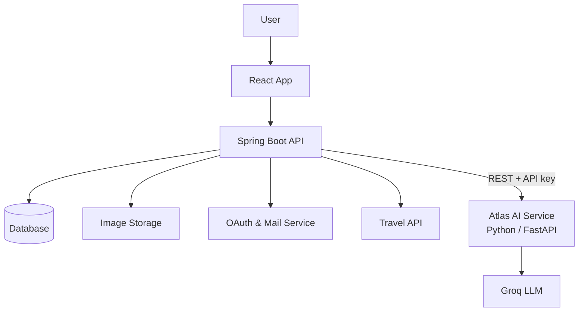

# ⚙️ Atlas Backend


> **Atlas Backend** is the powerful engine behind the **Atlas travel platform**, providing secure APIs, intelligent travel recommendations, and seamless integration with external services such as **Amadeus**, **Supabase**, and **Google Mail Service**.  
> Built for scalability, security, and speed with **Spring Boot 3** and **Java 21**.

---

## 👩‍💻 Developer
**Luisa Cerin Ogbeiwi**

---

### 🔗 Integrations
- **Amadeus API** → Flight & activity data  
- **Supabase** → Secure file and image storage  
- **Google OAuth + JWT** → Authentication & authorization  
- **Google Mail Service** → Password reset via email  
- **[Atlas AI Service](https://github.com/browny26/atlas-ai_service)** (Python/FastAPI + Groq) → AI-generated itineraries  

---

## 🌐 Live Demo

[atlas.vercel.app](https://atlas-works.vercel.app)

## 🗺️ Related Project

**[Atlas Frontend (React + Vite)](https://github.com/browny26/atlas-frontend)**

---

## ✨ Features

- 🔐 **User Authentication:** Secure login & registration with **JWT** and **Google OAuth**
- 🧳 **Itinerary Management:** Create, update, and retrieve personalized itineraries
- 🤖 **AI-Powered Itineraries:** Generated by the dedicated Python AI microservice
- ✈️ **Amadeus Integration:** Access flight and activity data in real time
- 🖼️ **File Storage:** Upload and manage images through **Supabase**
- 📧 **Password Reset:** Send recovery emails using **Google Mail Service**
- 🌐 **CORS Configuration:** Secure cross-origin communication with the frontend

---

## 🧩 Tech Stack

- **Language:** Java 21  
- **Framework:** Spring Boot 3  
- **Security:** Spring Security (JWT + Google OAuth)  
- **Database:** PostgreSQL  
- **AI Integration:** Atlas AI Service (REST, `RestClient`)  
- **Storage:** Supabase  
- **Mail Service:** Google Mail API  
- **Build Tool:** Maven  
- **Deployment:** Render  
- **Containerization:** Docker  

---

## 🚀 Getting Started

### ✅ Prerequisites
- Java 21 or higher  
- Maven  
- PostgreSQL  
- (Optional) Docker  

### 🏗️ Build and Run

1. Clone the repository:
   
   ```
   git clone https://github.com/browny26/atlas-backend.git 
   cd atlas-backend
   ```
   
3. Build the project:

   ```
   ./mvnw clean install
   ```

3. Run the application:

   ```
   ./mvnw spring-boot:run
   ```

5. The API will be available at:

   ```
   http://localhost:8080
   ```

## ⚙️ Configuration

Configuration lives in `src/main/resources/application.properties`.
**Secrets are never committed**: they are read from environment variables
(a local `.env` file is supported through `spring-dotenv` and is git-ignored).

| Variable | Description |
|---|---|
| `DB_URL`, `DB_USERNAME`, `DB_PASSWORD` | PostgreSQL connection |
| `JWT_SECRET` | JWT signing key |
| `GOOGLE_CLIENT_ID`, `GOOGLE_CLIENT_SECRET` | Google OAuth |
| `SPRING_MAIL_USERNAME`, `SPRING_MAIL_PASSWORD` | Gmail SMTP for password reset |
| `SUPABASE_SERVICE_KEY` | Supabase storage key |
| `AMADEUS_API_KEY`, `AMADEUS_API_SECRET` | Amadeus API |
| `AI_SERVICE_URL` | URL of the [AI service](https://github.com/browny26/atlas-ai_service) (default `http://localhost:8000`) |
| `AI_SERVICE_API_KEY` | Shared secret, must equal `SERVICE_API_KEY` of the AI service |
| `JPA_SHOW_SQL` | `true` to log SQL (default `false`) |

## 🤖 AI itinerary generation

The backend does not talk to the LLM directly. Prompts, model calls and output validation
live in the Python **Atlas AI Service**. This keeps each service focused on one job:

- `AiItineraryClient` calls `POST /v1/itineraries` with a typed request (`RestClient`,
  connect/read timeouts, `X-API-Key` header).
- `AiItineraryMapper` converts the AI service's typed contract (numeric costs) into the
  shape used by the frontend and the database. The two sides can evolve independently.
- If the AI service is down, `GlobalExceptionHandler` answers **502** with a clear message.

---

## 📡 API Endpoints

| Endpoint         | Description                         |
| ---------------- | ----------------------------------- |
| `/api/auth`      | Authentication & authorization      |
| `/api/user`      | User management                     |
| `/api/itinerary` | Create, edit & retrieve itineraries |
| `/api/amadeus`   | Integration with Amadeus travel API |
| `/api/storage`   | File upload & download via Supabase |

---

## 🧭 Architecture Overview

The backend follows a **modular layered architecture**, ensuring scalability and maintainability.



---

## 📄 License

This project is licensed under the **MIT License**.

---

## 💬 Contact

For questions or collaborations:  
📧 **Luisa Cerin Ogbeiwi**
